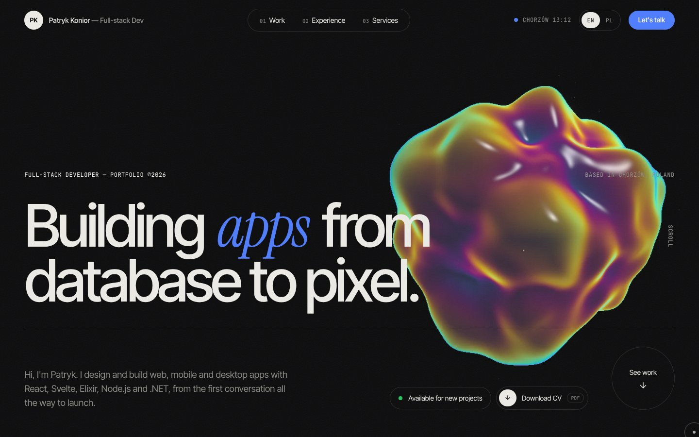
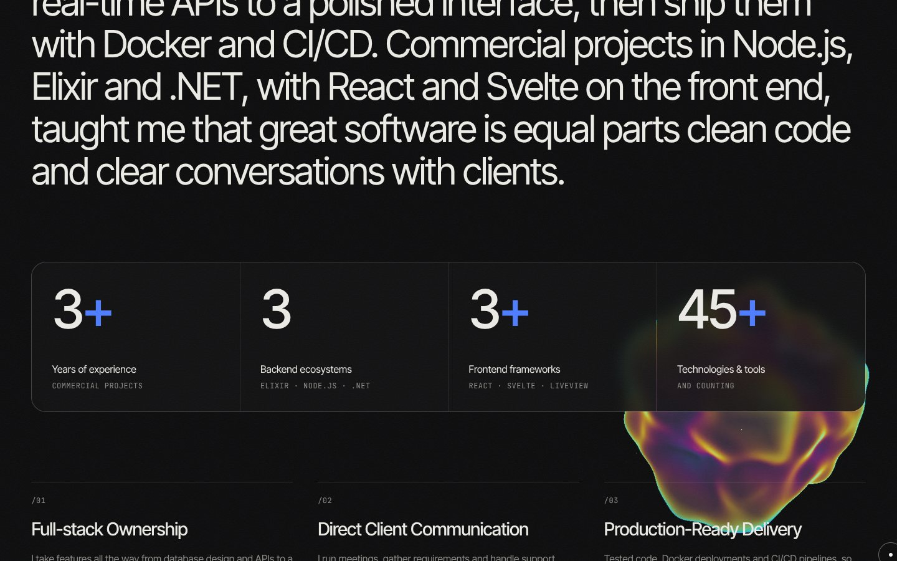
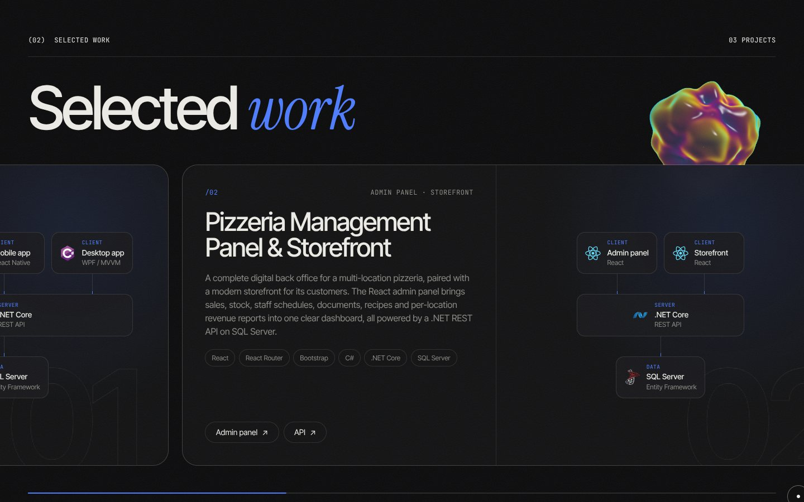
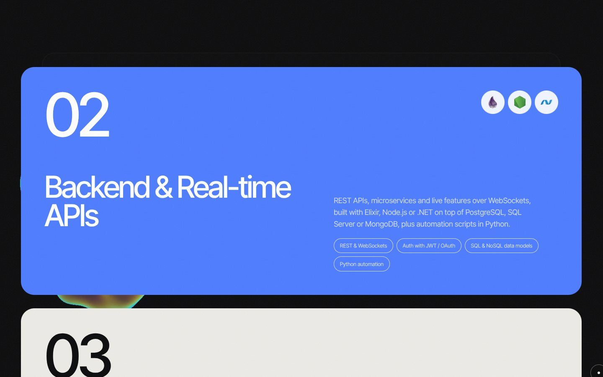
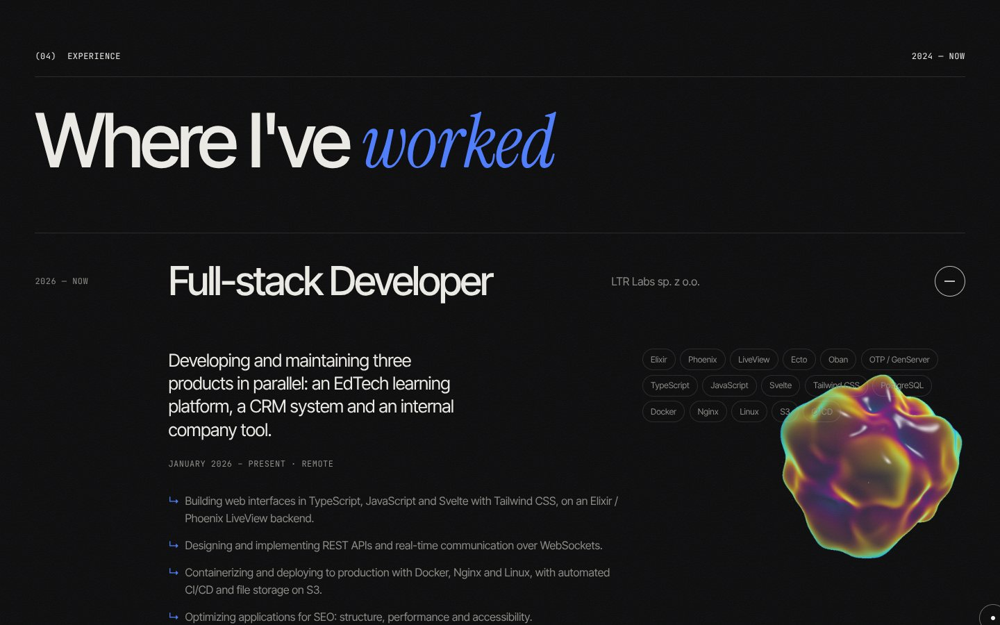
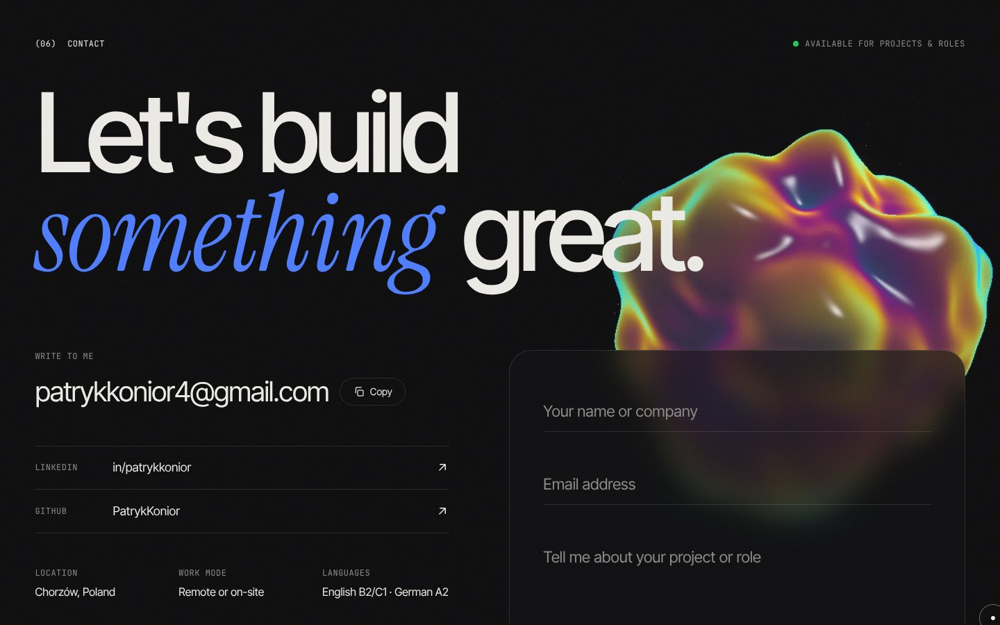
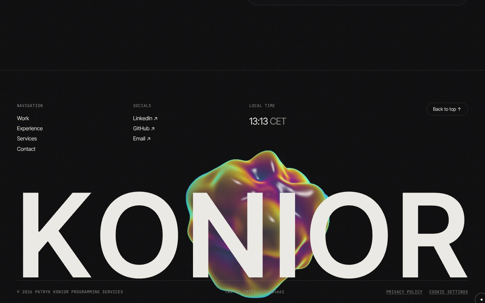
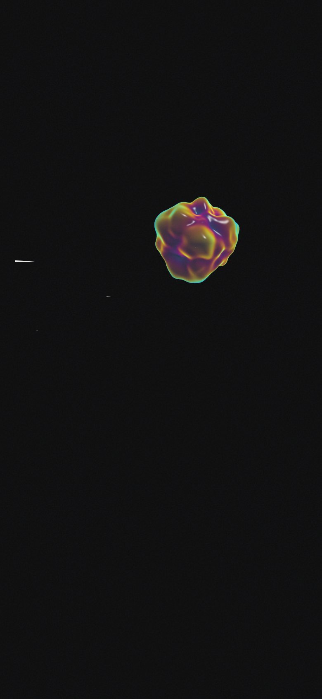
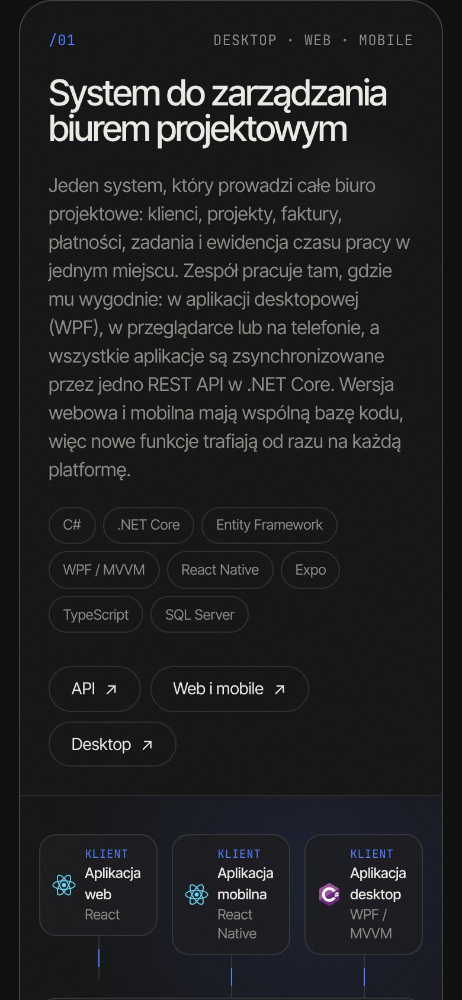

# Patryk Konior — Portfolio 2027

My personal site and business card as a full-stack developer: **Patryk Konior Programming Services**, B2B, Chorzów, Poland.

A dark, cinematic one-pager in English and Polish, built around a single WebGL scene: an iridescent, shader-driven blob that travels and reshapes itself with every section as you scroll.



## Highlights

- **One continuous WebGL scene.** A custom GLSL blob (simplex-noise displacement, iridescent fresnel shading, bloom) moves, scales and recolours per section, and reacts to the pointer and to scroll speed.
- **Bilingual, EN / PL.** Switching language makes the blob swell until it floods the screen, swaps the copy underneath and shrinks back, while labels decode with a scramble effect. The language comes from `?lang=`, the last choice or the browser.
- **Scroll choreography with GSAP.** A preloader, SplitText headline reveals, scroll-lit About copy, a pinned horizontal project gallery, stacking service cards, an experience accordion and a velocity-reactive tech marquee, on top of Lenis smooth scrolling.
- **Details.** A custom cursor, magnetic buttons, film grain, a live local clock and an animated *Download CV* button.
- **Built to hold up.** The 3D steps down on its own on slow devices (lighter scene, then a pre-rendered image), stops moving with `prefers-reduced-motion`, and loads in its own chunk so the page paints first.
- **Ready for production.** Full SEO (meta and social tags, JSON-LD for the person and the business, hreflang, sitemap, robots.txt), a privacy policy, a GDPR note on the contact form, a custom cookie banner with Google Analytics Consent Mode v2, and fonts served locally.

| | |
|---|---|
|  |  |
|  |  |
|  |  |

<p>
  
  
</p>

## Stack

React 19 · Vite · Three.js / React Three Fiber · custom GLSL shaders · GSAP (ScrollTrigger, SplitText, ScrambleText) · Lenis · Tailwind CSS 4 · EmailJS

## Branches

- **`main`** — production. What is deployed.
- **`dev`** — day-to-day work. Merge into `main` when a change is ready to go live.

## Run it

```bash
npm install
npm run dev      # local dev server
npm run build    # production build in dist/
npm run lint
```

## Configuration

- **`.env`** — copy `.env.example` and fill in the `VITE_APP_EMAILJS_*` keys for the contact form.
- **`site.config.js`**
  - `url` — the domain (e.g. `https://patrykkonior.dev`). Turns on canonical and hreflang tags, absolute social-preview URLs and `sitemap.xml`.
  - `gaMeasurementId` — a Google Analytics 4 ID. Turns on the cookie banner; GA only loads after consent. Empty means no analytics, no cookies, no banner.
  - `preview` — shows the cookie banner and the CV buttons before a GA ID or CV files exist. Keep both `false` in production.
- **CV** — put `Patryk-Konior-CV-EN.pdf` and/or `Patryk-Konior-CV-PL.pdf` in `public/`. The *Download CV* buttons appear automatically for the language whose file exists.
- **Copy** — every text on the site lives in `src/i18n/en.js` and `src/i18n/pl.js`; links, stack and icons are in `src/constants/index.js`.
- **Testing the 3D fallback** — `?lite` forces the pre-rendered image, `?full` skips the performance checks.

## Contact

[patrykkonior4@gmail.com](mailto:patrykkonior4@gmail.com) · [LinkedIn](https://www.linkedin.com/in/patrykkonior/) · [GitHub](https://github.com/PatrykKonior)

© Patryk Konior Programming Services · NIP 6272804661
